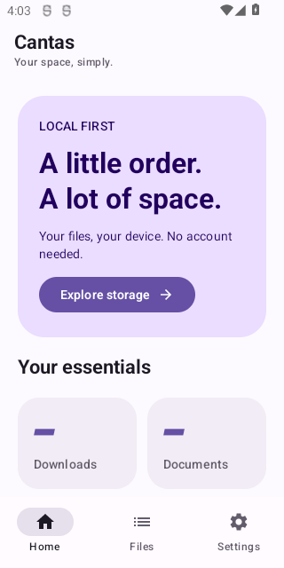
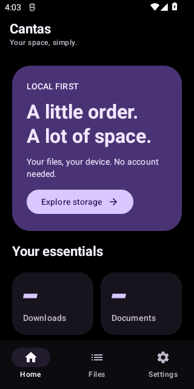
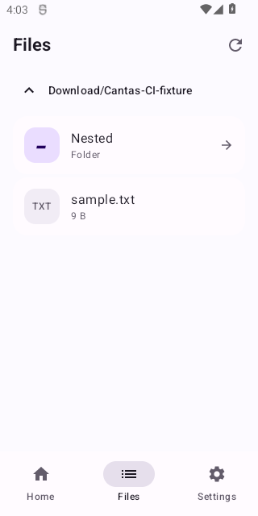

# Cantas 0.1 alpha — première application native

**[Télécharger le TEST Cantas](https://github.com/JCVERSA/rea/actions/runs/38678972198/artifacts/11947673184)** : ZIP contenant `Cantas-0.1.0-alpha01-TEST.apk` et son SHA-256. GitHub peut demander une connexion ; rétention14 jours. Pas une release.

- Identifiant indépendant : `app.cantas.jcversa` ; installation à côté de File Manager+, **sans désinstaller l'ancienne application**.
- Source du build : `87a011927db48498e3851d4d8b3f5017f104b766`.
- SHA-256 APK consigné par CI : `ccfc8f9cf8b7f6aa3fa510090ce8f1862ec271b1436ee2d0420b909f7a12a3d1`.
- [CI38678972198 réussie](https://github.com/JCVERSA/rea/actions/runs/38678972198) : compilation, tests JVM, lint, instrumentation et consultation réelle de fichiers synthétiques sur émulateurs Android7/API24 x86 et Android12/API31 x86_64.

## Ce qui fonctionne dans ce jalon

Accueil Compose original, navigation inférieure, raccourcis de dossiers réels, consultation du stockage principal après consentement, navigation parent/dossiers, actualisation, états vides/erreurs ; thème système/clair/AMOLED conservé en préférences locales. Ouverture d'un fichier choisi dans une app externe implémentée avec grant de lecture seule, mais pas testée de bout en bout avec un lecteur tiers réel.

Français/anglais selon la langue Android. Aucun Internet demandé, ni publicité, télémétrie, compte obligatoire, code décompilé ou SDK de l'ancienne application. Les applications externes choisies par l'utilisateur ont leurs propres permissions et politiques.

**Lecture seule : pas de suppression, copie ou déplacement dans ce jalon.** SD/USB/SAF, Shizuku, recherches, opérations complètes, archives, lecteurs internes, NAS/cloud/serveurs et corbeille restent à implémenter. [Registre de parité et prochains jalons](CANTAS_ROADMAP.md).

## Preuves et limites

[Rapports complets](../analysis/cantas/38678972198/) : six tests JVM, un scénario d'instrumentation par émulateur, fichiers synthétiques affichés, sous-dossier vide puis retour parent, aucun crash enregistré. Les vérifications de pixels post-CI confirment quatre fonds clair/AMOLED. Ces tests ne constituent pas un benchmark ni une validation exhaustive du système de permissions ou de fichiers.

| Accueil clair, Android12 | Accueil AMOLED, Android12 |
| --- | --- |
|  |  |

- Lint : **0 erreurs, 11 avertissements** conservés. Politique Play all-files, cible/dépendances moins récentes, règle d'extraction/backup à compléter et suggestions KTX. `allowBackup=false` est déclaré ; cela ne vaut pas garantie sur tous les mécanismes OEM de transfert. Pas encore de secrets/connexions persistés.
- Compose embarque `libandroidx.graphics.path.so`, avec variantes armeabi-v7a/arm64-v8a/x86/x86_64 contrôlées. Premier run38678652899 : compilation/tests/lint réussis, puis échec du guard qui exigeait à tort l'absence de natif ; guard corrigé vers présence ARM32. Aucun contournement des tests.
- Maximum1,000 éléments visibles ; `File.listFiles()` énumère encore tout le dossier avant le filtrage. Ce n'est pas une vraie pagination bornée. L'annulation évite les résultats obsolètes, sans interruption forcée de ce listing bloquant.
- Le sandbox ne résout pas Google/Maven/Gradle directement ; build effectué sur CI. Le checksum Gradle utilisé par le build réussi a ensuite été épinglé dans le source. Les modifications finales de documentation/checksum ne changent pas le Kotlin/XML de l'application livrée.
- APK non récupéré/re-hashé localement : les téléchargements d'artifacts redirigent vers un hôte non autorisé au sandbox. Le hash provient du job CI. Ne pas annoncer une vérification locale inexistante.
- Pas de validation physique Tecno ARM32 Android12/2Go, ni de garantie Android7–15 complète. Français rendu sur appareil, accessibilité, performance, stockage externe et intégrations restent à tester.

## Installation et contrôle manuel

1. Installer Cantas à côté du gestionnaire existant. Ce TEST est signé temporairement ; les builds ultérieurs peuvent changer de signature. Ne jamais supprimer File Manager+ pour l'installer.
2. Ouvrir l'accueil, régler clair/AMOLED/système et revenir sur Accueil.
3. Autoriser l'accès au stockage uniquement si souhaité ; Android conserve ses restrictions. Sur Android11+, le bouton ouvre les réglages « accès à tous les fichiers ».
4. Parcourir un dossier, entrer dans un sous-dossier, revenir au parent. Tester un fichier non sensible dans une application externe habituelle si souhaité. Aucune suppression nécessaire.
5. Vérifier le défilement et la lisibilité en français sur le Tecno. Ne pas envoyer de documents, mots de passe ou captures de chemins personnels pour le diagnostic.

Une future désinstallation de Cantas, si requise par une autre signature TEST, peut supprimer ses données privées/scopées : mettre à l'abri les données nécessaires avant une décision manuelle. Aucun script ADB du dépôt ne doit être lancé sur le téléphone.
