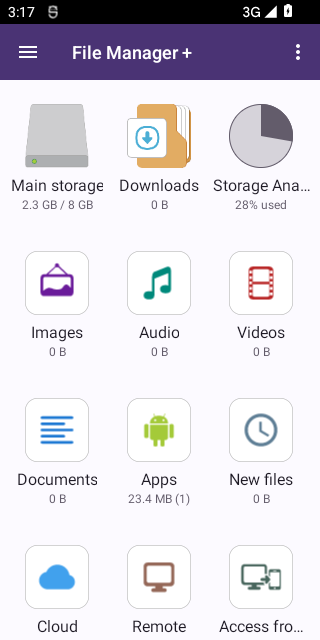
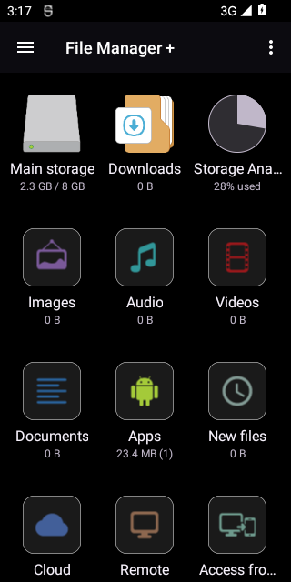
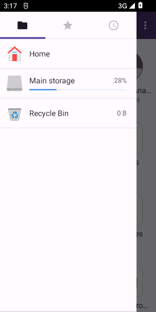
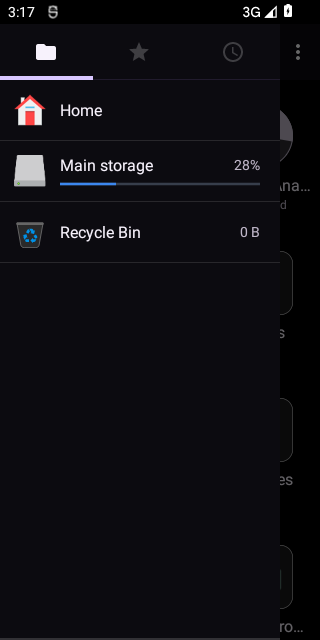

# Lot cumulatif — Slate Views + protections ciblées

Ce lot conserve TLS Nextcloud, HTTP média sur loopback et grants typés. Il ajoute des protections ciblées et **des changements visuels réels**, sans migrer vers Compose ni relier de nouveau la table de ressources. Usage personnel, APK TEST uniquement ; pas une release ni une certification de toutes les fonctions.

## Livraison retenue — CI réussie

- Source du build : **e017c06c854b2b0a3accf06a5af5601129a78f4c**.
- [Run 38675070344 réussi](https://github.com/JCVERSA/rea/actions/runs/38675070344), build + validate + publish.
- **[APK TEST à télécharger](https://github.com/JCVERSA/rea/actions/runs/38675070344/artifacts/11946460786)** : ZIP contenant `base-slate-safety-test.apk`, signature temporaire, rétention GitHub 14 jours. Connexion GitHub possiblement nécessaire. Ne pas utiliser l’artifact interne unsigned.
- SHA-256 APK, enregistré par CI : `48cb08c2c97de481cdb870783b4e2b2a372e07cd432a3bbc1a51cb5a62d93b04`.
- [Rapports complets](../analysis/slate-safety/38675070344/), [ancres du patch](../analysis/slate-safety/source-anchors.json), [plan exact d’overlay](../analysis/slate-safety/source-overlay-plan.json), [contrôle manuel téléphone](SLATE_PHONE_CHECKLIST.md).
- 62 tests Python locaux réussis ; compilation syntaxique Python, shell et `git diff --check` réussis. CI : 37 cas grants JVM, 43 cas nouveaux helpers JVM ; suites chargées depuis l’APK sur Android ; managers originaux/candidats 15 cas chacun ; extracteur ZIP réel original/candidat, 48 cas de couleurs et 6 cas de lecture de préférence thème.
- 21 987 classes attendues, **aucune différence de méthodes/contrats normalisés**, 6 443 IDs publics inchangés, manifeste binaire et assets/bibliothèques conservés. Aucun contrôle prétendument octet-identique des DEX.
- Installation/démarrage original et candidat réussis sur émulateur Android12 x86_64, RAM configurée2Go, réseau du UID rejeté. Pas une validation Tecno ARM32 ni un benchmark.
- Rendu de l’activité vérifié : accueil clair `(252,250,255)`, tiroir clair `(255,251,255)`, accueil nuit `(0,0,0)`, tiroir nuit `(12,11,16)`. Captures réelles ci-dessous, inspectées après CI.

| Clair | AMOLED |
| --- | --- |
|  |  |
|  |  |

Limite d’accès sandbox : `gh run download` du TEST a échoué sur la redirection Azure Blob (hôte non autorisé). Aucun APK n’a été récupéré/re-hashé localement ; le hash ci-dessus provient du job CI et l’artifact signé reste disponible via le lien utilisateur GitHub. Pas de clé privée ni d’URL de téléchargement signée copiée dans les livrables.

## Changements

| Surface | Modification | Limite |
| --- | --- | --- |
| Provider (AUD-08) | Attente de métadonnées limitée à 30 s ; expiration/interruption → curseur vide déjà prévu ; drapeau d’interruption restauré | Le worker backend n’est pas annulé. Pas de délai ajouté aux transferts/lectures de fichiers. Cela ne prouve pas l’absence d’ANR |
| FTP (AUD-06 partiel) | Reader de **commandes de contrôle** limité à 8 192 caractères, CR/LF/CRLF et EOF conservés ; dépassement → IOException et nettoyage existant | Aucune limite sur la taille des fichiers. Quotas de connexions/threads, clients lents et délais globaux non corrigés |
| ZIP média embarqué (AUD-10) | Garde sur les chemins canoniques avec séparateur, pas un simple préfixe | Uniquement extracteur des bibliothèques embarquées ; pas une revue de tous les formats d’archives. Entrée provenant normalement d’un asset signé, exploitabilité distante non démontrée |
| Logs (AUD-11 partiel) | Arguments de commandes FTP et URL de callback Nextcloud remplacés par `[redacted]` dans deux logs ciblés | Ni suppression de la commande ni changement du parsing. Pas de garantie que tous les logs de toutes les dépendances sont exempts de secrets |
| Interface | Palette lavande, surfaces claires et fond AMOLED noir, espacement accueil/navigation, rayon de carte 18 dp | Widgets Views existants conservés. Inspiration Material3, **pas une migration complète des composants/styles vers Material3** |

### Inspiration visuelle réellement consultée

[SwiftSlate-ng — Theme.kt](https://github.com/JCVERSA/SwiftSlate-ng/blob/main/app/src/main/java/com/jcversa/swiftslate/ui/theme/Theme.kt) : fond AMOLED `#000000`, surfaces teintées, Sparkle Lavender, rayons arrondis. Les rôles sont adaptés à l’interface existante ; les classes Compose du dépôt de référence ne sont pas incorporées. Pas de nouvelle animation, temporisation de mouvement forcée ni bibliothèque runtime. Le comportement d’animation existant n’a pas été audité intégralement.

## Ressources : solution au blocage des 20 IDs Material

`scripts/slate_resources.py` travaille sur les ressources **compilées originales**, après restauration par le script témoin :

- 40 valeurs de couleurs dans les configurations originales, avec références aux rôles jour/nuit existants ;
- 25 valeurs de dimensions, dans six XML compilés : `desktop2_item`, `desktop_item`, `desktop_item_new`, `nav_fixed_list_item`, `fragment_desktop`, `fragment_desktop2` ;
- tailles de fichiers, offsets de chunks, strings, noms de ressources, structures de vues, IDs, styles et références XML conservés ;
- défaut `night_mode` XML `1` → `-1` et fallback du getter identique : **seulement en absence de choix enregistré** (ou valeur non numérique, qui utilisait déjà un fallback). Aucun écrasement de préférence existante par le patch ;
- aucun nouveau widget, écran masqué, permission ajoutée, suppression de fonction ni modification de données utilisateur ;
- refus des encodages/ancres inattendus ; fingerprint de la base obligatoire ;
- comparaison du résultat APK à l’overlay exact, pas une tolérance générale aux modifications de ressources.

Le réglage de thème utilise une valeur INT_DEC déjà présente dans `res/xml/settings.xml` : un seul entier modifié, sans ajouter de string ni modifier le schéma des préférences. Les branches héritées liées au thème restent actives (y compris les conditions d’affichage publicitaire de la base) ; aucun patch de licence, paiement ou SDK publicitaire. Le rendu clair/sombre de tous les comptes et réglages n’est pas garanti par ces tests.

Ce n’est **pas** un compilateur ARSC/AXML général. Les IDs non mentionnés ne sont pas renumérotés. Les sources XML décodées de référence restent inchangées ; l’overlay et son journal constituent le patch reproductible. La compilation complète de ressources qui remappait 20 IDs n’est pas utilisée pour l’interface de ce lot.

## Reproduction

Préconditions : JDK17, Android SDK plateforme31/build-tools35.0.0, Apktool3.0.3 au SHA épinglé dans le workflow ; workspace neuf. Les clés restent privées, absentes des artifacts.

```sh
python3 scripts/verify_base.py
python3 scripts/prepare_witness.py
python3 scripts/nextcloud_tls_patch.py apply
python3 scripts/http_loopback_patch.py apply
bash scripts/build_media_grant.sh
python3 scripts/media_grant_patch.py apply
bash scripts/build_safety.sh
python3 scripts/safety_patch.py apply
java -Xmx2g -jar .tools/apktool.jar b --copy-original .work/witness/tree -o .work/witness/unsigned.apk
python3 scripts/restore_witness_resources.py
python3 scripts/slate_resources.py apply
bash scripts/sign_witness.sh
# Décompiler le chemin signé indiqué par .work/witness/diagnostic/path.txt
# vers .work/witness/roundtrip, puis :
python3 scripts/verify_slate.py
```

Workflow : `.github/workflows/slate-safety.yml`, uniquement branche `arena/3a37ecd7-rea`. Les scripts `probe_*` nécessitent un **émulateur jetable isolé** ; ne pas les lancer sur le Tecno. L’utilisateur teste par installation manuelle, sans ADB.

## Vérification et échecs conservés

- Tests Python : guards d’ancres, refus de répétition, méthodes ciblées seulement, octets autorisés de l’overlay, invariants historiques.
- JVM : 37 cas grants et 43 cas nouveaux helpers.
- Vérification assemblée : overlay exact, manifeste binaire identique, assets/bibliothèques identiques, IDs publics inchangés, ensemble exact des classes et contrats/méthodes normalisés.
- Android : sondes HTTP/grants conservées ; nouvelle sonde de l’extracteur ZIP réel avec fichiers synthétiques, helpers chargés depuis l’APK, couleurs Android jour/nuit. Ni compte cloud ni fichier personnel.
- Captures : véritable activité lancée sur émulateur, accès réseau du UID bloqué, autorisations de stockage synthétiques, modes système clair/sombre et geste d’ouverture du tiroir. Ce n’est pas une validation UX/TalkBack ou une preuve que toutes les préférences de thème suivent le système. Après inspection du premier run réussi, le contrôle impose aussi la couleur réelle des surfaces de l’accueil et du tiroir : clair `#FCFAFF`/`#FFFBFF`, nuit `#000000`/`#0C0B10`.

**Premier run 38673369408 : échec du vérificateur**, après passage des invariants de ressources/manifeste/IDs. Cause : le normaliseur de méthodes historique refusait les interfaces marqueurs/classes sans méthodes. Le vérificateur cumulatif a été corrigé pour comparer leur contrat complet, sans les ignorer. Aucune livraison de ce run raté. Les rapports sont conservés dans `analysis/slate-safety/38673369408/`. **Second run 38673661769 : échec strict de comparaison des contrats**, limité à 24 classes. Les méthodes normalisées correspondent ; dexlib a omis des valeurs statiques explicites par défaut (`false`/`null`). Une normalisation typée, limitée aux valeurs par défaut des champs statiques, a été ajoutée avec tests négatifs (true, non-null, accès/type/opcodes). Les contrats ne sont pas ignorés. Rapports conservés dans `analysis/slate-safety/38673661769/`. **Troisième run 38674060896 : tests automatisés réussis**, dont tous les contrats/méthodes normalisés des 21 987 classes, installation/démarrage, ZIP réel, 43 cas helpers Android et 48 cas de couleurs Android. **L’inspection visuelle a ensuite révélé que les captures étiquetées `dark-*` étaient encore claires** : les étiquettes indiquaient le mode système demandé, pas le thème effectivement rendu. Le réglage initial de la base force Light (`1`). Correction ciblée du défaut non configuré vers System (`-1`), contrôle des pixels et six cas de lecture des préférences ajoutés. Les anciennes captures et rapports ne sont pas réécrits. **Quatrième run 38675070344 : tous les nouveaux contrôles passent**, dont les quatre couleurs de surfaces réelles et les six cas de préférences. C’est le build retenu en tête du document.

## Ce qui reste ouvert, sans dissimulation

| Constat | État après ce lot |
| --- | --- |
| AUD-01 signature/provenance | Signature originale de développement connue ; TEST signé séparément. Identité de release personnelle stable toujours distincte |
| AUD-02 TLS | Annulation ciblée implémentée ; certificats réels/Nextcloud/CA privée et UX de confiance non testés |
| AUD-03 secrets/crypto | **Non corrigé** : migration Keystore/fail-open et clés SFTP. Pas de conversion destructrice ou fallback modifié sans fixtures et transaction/UX d’erreur |
| AUD-04 HTTP/grants | Loopback et règles typées implémentés ; symlinks/backend canonique, révocation et authentification des autres apps locales ouverts |
| AUD-05 | Retiré : grants enfant effectivement valides selon parseur Android12 |
| AUD-06 ressources réseau | Mémoire d’une commande FTP bornée ; concurrence, threads et clients lents ouverts |
| AUD-07 dépendances/protocoles | Pas d’upgrade aveugle de classes obfusquées ; compatibilité des backends et versions transitoires non résolue |
| AUD-08 fiabilité | Attente de métadonnées bornée ; worker, autres waits, annulation/backend et ANR de bout en bout ouverts |
| AUD-09 favoris | **Migration destructrice héritée non corrigée**. Schéma/version3 inchangés dans ce lot ; aucune DB ouverte/migrée par les scripts. Fixtures historiques manquantes |
| AUD-10 ZIP | Frontière canonique ciblée corrigée, tests synthétiques de l’extracteur ; pas de preuve d’un exploit distant |
| AUD-11 logs | Deux logs sensibles expurgés ; revue de tous les chemins tiers restante |

Également non validés : Android7–15 dans son ensemble, Tecno Android12 ARM32/2Go, lecture/seek/playlists/sous-titres/lecteurs externes, NAS/cloud/WebDAV/SAF, performance, accessibilité et toutes les préférences. Les limites ne signifient pas que ces fonctions sont supprimées ; elles signifient qu’on ne peut pas honnêtement les déclarer testées ici.

### Installation manuelle

APK temporairement signé : ne pas supposer qu’il peut remplacer l’original ou un TEST signé par une autre clé. Aucune désinstallation automatique. Avant un remplacement qui exige une désinstallation, mettre à l’abri les réglages, connexions et tout fichier nécessaire dans les espaces privés/scopés de l’application : Android peut les supprimer lors de la désinstallation. Ne jamais partager mots de passe, clés privées ou dumps de préférences dans les rapports.
